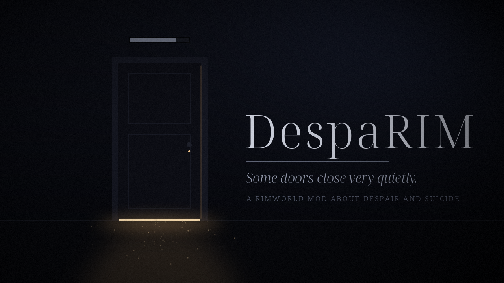

# DespaRIM Beta 1.0

  

> ⚠️ **Content warning:** this mod depicts suicide. If you are struggling with thoughts of suicide, you are not alone. Help is available: https://findahelpline.com

*Sometimes a person doesn't scream, smash things or run off into the wasteland. Sometimes they just close the door behind them.*

The first public beta of **DespaRIM** for RimWorld 1.6. It adds a new extreme mental break, **Despair**: a colonist who lives with very low mood for many days in a row may lock themselves in a room. You have only a few hours to get to them.

### ✨ What's inside

- **Despair mental break.** Builds up only while mood stays below the threshold without interruption, then fires by chance (MTB), with no scripted events
- **Locked door and a timer.** The pawn locks themselves in their bedroom, any suitable room, or their prison cell, and a countdown bar appears above their head
- **Rescue.** Break down the door (right-click), bring a colonist right next to them, stun, down or arrest them
- **Consequences.** "Total despair", "Shock and guilt", "Second chance" for the survivor and "We were too late" for the colony. Traits and ideology are respected
- **No death loops.** While "Total despair" lasts, the break can't happen again
- **Mod settings.** Mood threshold, days required, MTB and rescue time are all configurable
- **Dev Mode tools.** Inspector buttons and a "DespaRIM" debug actions section
- **Languages:** English, Russian

### 📦 Installation

1. Download **`DespaRIM-v1.0.0-beta.zip`** below
2. Extract it into `<RimWorld>/Mods/`
3. Enable **Harmony** and **DespaRIM** (DespaRIM below Harmony)

Safe to add to an existing save. Removing it during an active break is not recommended.

### 🔧 Requirements

- RimWorld 1.6
- [Harmony](https://steamcommunity.com/sharedfiles/filedetails/?id=2009463077)
- No DLC required

### 🧪 Beta notice

This is a beta: balance values may change and bugs are possible. If something breaks, please open an [issue](https://github.com/voideez/DespaRIM/issues) and attach your log (`Player.log`).

---

<b>🇷🇺 Описание на русском</b>

> ⚠️ **Предупреждение:** мод затрагивает тему самоубийства. Если вас посещают мысли о самоубийстве, вы не одни. Помощь есть: https://findahelpline.com

*Иногда человек не кричит, не крушит и не бежит в пустошь. Иногда он просто закрывает за собой дверь.*

Первая публичная бета **DespaRIM** для RimWorld 1.6. Мод добавляет новый экстремальный срыв, **«Отчаяние»**: колонист, который много дней подряд живёт с очень низким настроением, может запереться в комнате. У вас останутся считанные часы.

#### ✨ Что внутри

- **Срыв «Отчаяние».** Копится, только пока настроение непрерывно ниже порога, затем срабатывает случайно (MTB), без сценариев
- **Запертая дверь и таймер.** Пешка запирается в спальне, подходящей комнате или тюремной камере, над головой появляется шкала времени
- **Спасение.** Выбейте дверь (ПКМ), подведите колониста вплотную, оглушите, свалите с ног или арестуйте
- **Последствия.** «Тотальное отчаяние», «Шок и вина», «Второй шанс» у спасённого и «Мы не успели» у колонии. Учитываются черты характера и идеология
- **Без смертельных циклов.** Пока висит «Тотальное отчаяние», повторный срыв невозможен
- **Настройки мода.** Порог настроения, число дней, MTB и время на спасение настраиваются
- **Инструменты Dev Mode.** Кнопки в инспекторе и раздел «DespaRIM» в отладочных действиях
- **Языки:** английский, русский

#### 📦 Установка

1. Скачайте **`DespaRIM-v1.0.0-beta.zip`** ниже
2. Распакуйте в `<RimWorld>/Mods/`
3. Включите **Harmony** и **DespaRIM** (DespaRIM ниже Harmony)

Безопасно добавлять в текущее сохранение. Удалять во время активного срыва не рекомендуется.

#### 🧪 Бета

Это бета-версия: баланс может меняться, возможны баги. Если что-то сломалось, создайте [issue](https://github.com/voideez/DespaRIM/issues) и приложите лог (`Player.log`).

