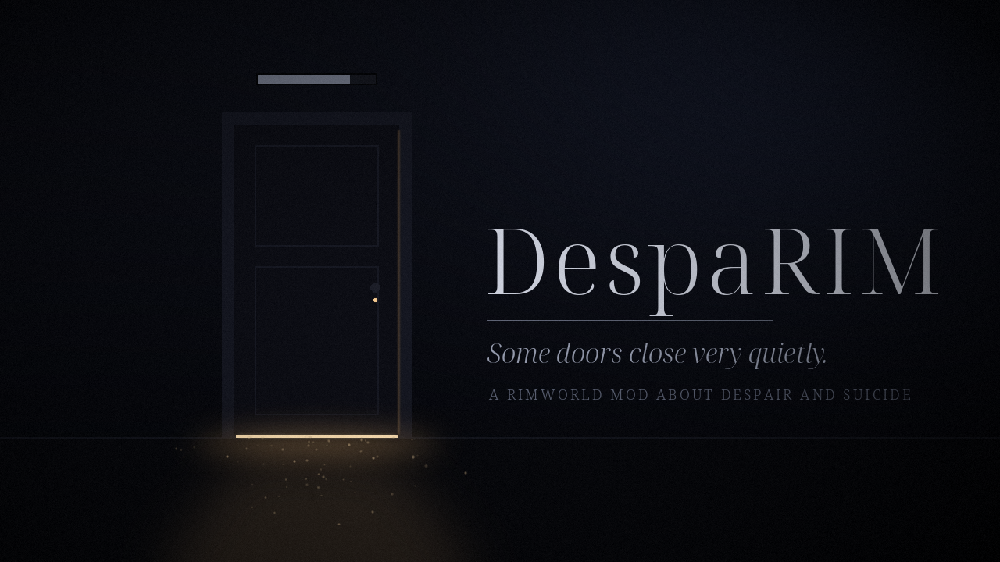

<h1 align="center">DespaRIM🚪</h1>

<p align="center">
  
  
  
  
  
  
  
  
</p>

## [Russian README.md](README_ru.md)

<p align="center">
  
</p>

> ⚠️ **Content warning:** this mod depicts suicide. If you are struggling with thoughts of suicide, you are not alone. Help is available: https://findahelpline.com

*Sometimes a person doesn't scream, smash things or run off into the wasteland. Sometimes they just close the door behind them.*

DespaRIM is a RimWorld 1.6 mod that adds a new extreme mental break: Despair, a suicide attempt. A colonist who lives with mood below a threshold for many days in a row may one day break, lock themselves in a room, and leave you only a few hours to save them.

- No scripts, just chance (MTB)
- A locked door, a timer above their head and a race against the clock
- Colony-wide consequences that respect traits and ideology
- Every threshold and chance is configurable

---

### How it works

- Stress only builds while mood stays below the threshold (**20%** by default) without interruption. If mood rises above it, the counter resets
- Until the required number of days has passed (**10** by default), the break is impossible. After that there is a small daily chance (MTB, **60 days** by default)
- The despairing pawn locks themselves in their bedroom, any suitable room, or their cell if they are a prisoner. A timer bar appears above their head (**2 in-game hours** by default)
- To save them: **break down the door** (right-click the locked door), bring a colonist right next to them, stun them, down them or arrest them
- If you are too late, the colonist dies and the whole colony carries the loss
- A rescued pawn goes through "Total despair", "Shock and guilt" and "Second chance". While "Total despair" lasts, a repeat break is impossible: no death loops

---

### Installation

**From Releases:**

Download `DespaRIM-*.zip` from [Releases](https://github.com/voideez/DespaRIM/releases/latest) and extract it into `<RimWorld>/Mods/`.

**From Source (GitHub):**

```bash
cd <RimWorld>/Mods
git clone https://github.com/voideez/DespaRIM.git
```

Enable **Harmony** and **DespaRIM** (DespaRIM below Harmony).

Safe to add to an existing save. Removing it from a save during an active break is not recommended.

---

### Settings

Every threshold, duration and chance can be changed in **Options → Mod settings → DespaRIM**.

Languages: English, Russian.

---

### Requirements

* RimWorld 1.6
* [Harmony](https://steamcommunity.com/sharedfiles/filedetails/?id=2009463077)
* No DLC required

---

### Building

Requires .NET SDK 6+ (or Visual Studio 2022 / Rider). The project is SDK-style and targets `net472`.
The built DLL goes to `1.6/Assemblies/`. Game and Harmony DLLs are **not** copied there.

```bash
cd Source
dotnet build -c Release

# custom game path:
dotnet build -c Release -p:RimWorldDir="D:\Games\RimWorld"
```

If the game isn't found, the project pulls reference assemblies from NuGet (`Krafs.Rimworld.Ref`, `Lib.Harmony`), so it builds on machines without RimWorld installed.

**Visual Studio 2022:** open `Source/DespaRIM.csproj`, adjust `RimWorldDir` if needed, pick **Release** → Build Solution.

**JetBrains Rider:** open `Source/DespaRIM.csproj`, set the game path in Settings → Build → MSBuild global properties → `RimWorldDir`.

---

### Testing (Dev Mode)

* Pawn inspector: **Dev: trigger Despair**, **Dev: 10 sec left**, **Dev: despair status**
* Debug actions → **DespaRIM** section: Trigger Despair break, Fill low-mood counter (MTB armed), Despair: 10 sec left, Despair: rescue now, Clear despair immunity, Log despair status

Test scenarios:

1. Trigger the break → the pawn walks to their bedroom and locks the door, a timer bar appears
2. Try to path another colonist through the door: it's blocked
3. Right-click the door → "Break down the door" → door breaks → bring a colonist adjacent → rescue; the survivor gets "Shock and guilt" and "Second chance"
4. "10 sec left" → death, a letter with Despair as the cause, the colony gets "we were too late"
5. Trigger the break normally again (Fill low-mood counter): it won't fire while "Total despair" is active

---

### Project structure

```
DespaRIM/
├── About/About.xml                         1.6 manifest, Harmony dependency
├── 1.6/Assemblies/DespaRIM.dll             compiled assembly
├── Defs/
│   ├── MentalBreakDefs/MentalBreaks.xml    MentalBreakDef + MentalStateDef
│   ├── JobDefs/Jobs_Despair.xml            Despair and Break down the door jobs
│   ├── ThoughtDefs/Thoughts_Despair.xml    -50 / -15 / +15 / colony -20
│   ├── HediffDefs/Hediffs_Despair.xml      health marker and cause of death
│   └── ThinkTreeDefs/ThinkTree_Despair.xml behavior hookup (insertTag, no patches)
├── Languages/
│   ├── English/Keyed/                      English (base language)
│   └── Russian/                            Keyed + DefInjected
└── Source/
    ├── DespaRIMMod.cs                      Mod, Harmony, DefOf
    ├── DespaRIMSettings.cs                 settings window
    ├── GameComponent_DespairTracker.cs     low-mood day counter and MTB rolls
    ├── MentalBreakWorker_Despair.cs        break conditions
    ├── MentalState_Despair.cs              room, lock, timer, rescue, death
    ├── JobDriver_DespairAct.cs             JobGiver + JobDriver, progress bar
    ├── JobDriver_BreakDespairDoor.cs       Break down the door + right-click option
    ├── DespairDoorLocks.cs                 thread-safe locked door registry
    ├── DespairUtility.cs                   candidates, room search, thoughts
    ├── DebugActions_Despair.cs             Dev Mode
    └── Patches/                            PawnCanOpen, dev inspector buttons
```
