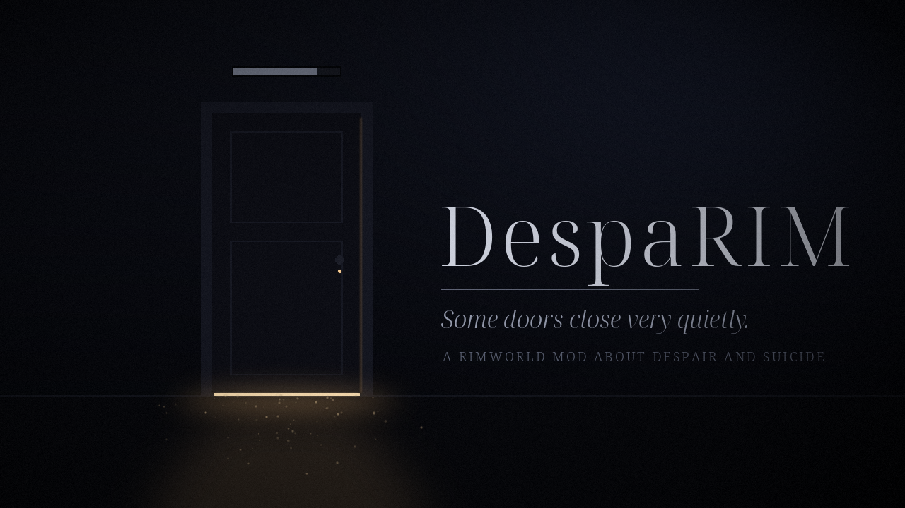

<h1 align="center">DespaRIM🚪</h1>

<p align="center">
  
  
  
  
  
  
  
  
</p>

## [English README.md](README.md)

<p align="center">
  
</p>

> ⚠️ **Предупреждение:** мод затрагивает тему самоубийства. Если вас посещают мысли о самоубийстве, вы не одни. Помощь есть: https://findahelpline.com

*Иногда человек не кричит, не крушит и не бежит в пустошь. Иногда он просто закрывает за собой дверь.*

DespaRIM — мод для RimWorld 1.6, который добавляет новый экстремальный срыв: «Отчаяние», попытку самоубийства. Колонист, который много дней подряд живёт с настроением ниже порога, может однажды сломаться, запереться в комнате, и у вас останутся считанные часы.

- Никакого сценария, только случайность (MTB)
- Запертая дверь, таймер над головой и гонка со временем
- Последствия для всей колонии с учётом черт характера и идеологии
- Все пороги и шансы настраиваются

---

###   Как это работает

- Стресс копится, только пока настроение держится ниже порога (по умолчанию **20%**) непрерывно. Если настроение поднимется выше, счётчик сбрасывается
- Пока не прошло нужное число дней (по умолчанию **10**), срыв невозможен. Потом каждый день есть небольшой шанс (MTB, по умолчанию **60 дней**)
- Отчаявшийся запирается в своей спальне, в любой подходящей комнате или в тюремной камере, если это заключённый. Над головой появляется шкала времени (по умолчанию **2 игровых часа**)
- Чтобы спасти: **выбейте дверь** (ПКМ по запертой двери), подведите колониста вплотную, оглушите, свалите с ног или арестуйте
- Если не успеть, колонист погибнет, а колония получит тяжёлую память об утрате
- Спасённый проходит через «Тотальное отчаяние», «Шок и вину» и «Второй шанс». Пока висит «Тотальное отчаяние», повторный срыв невозможен: смертельных циклов не будет

---

###   Установка

**Через Releases:**

Скачайте `DespaRIM-*.zip` со страницы [Releases](https://github.com/voideez/DespaRIM/releases/latest) и распакуйте в `<RimWorld>/Mods/`.

**Через GitHub:**

```bash
cd <RimWorld>/Mods
git clone https://github.com/voideez/DespaRIM.git
```

Включите **Harmony** и **DespaRIM** (DespaRIM ниже Harmony).

Безопасно добавлять в текущее сохранение. Удалять из сохранения во время активного срыва не рекомендуется.

---

###   Настройки

Все пороги, сроки и шансы меняются в **Настройки → Настройки модов → DespaRIM**.

Языки: английский, русский.

---

###   Требования

- RimWorld 1.6
- [Harmony](https://steamcommunity.com/sharedfiles/filedetails/?id=2009463077)
- DLC не обязательны

---

###   Сборка

Нужен .NET SDK 6+ (или Visual Studio 2022 / Rider). Проект SDK-style, цель `net472`.
Готовая DLL складывается в `1.6/Assemblies/`. DLL игры и Harmony туда **не** копируются.

```bash
cd Source
dotnet build -c Release

# другой путь к игре:
dotnet build -c Release -p:RimWorldDir="D:\Games\RimWorld"
```

Если игра не найдена, проект сам берёт reference-сборки из NuGet (`Krafs.Rimworld.Ref`, `Lib.Harmony`), так что собрать можно и на машине без игры.

**Visual Studio 2022:** откройте `Source/DespaRIM.csproj`, при необходимости поправьте `RimWorldDir`, конфигурация **Release** → Build Solution.

**JetBrains Rider:** откройте `Source/DespaRIM.csproj`, путь к игре задаётся в Settings → Build → MSBuild global properties → `RimWorldDir`.

---

###   Тестирование (Dev Mode)

- Инспектор пешки: **Dev: запустить «Отчаяние»**, **Dev: 10 сек. до конца**, **Dev: статус отчаяния**
- Debug actions → раздел **DespaRIM**: Trigger Despair break, Fill low-mood counter (MTB armed), Despair: 10 sec left, Despair: rescue now, Clear despair immunity, Log despair status

Сценарии проверки:

1. Запустить срыв → пешка уходит в спальню и запирается, появляется шкала над головой
2. Попробовать провести через дверь другого колониста: путь закрыт
3. ПКМ по двери → «Выбить дверь» → дверь ломается → подвести колониста вплотную → спасение, у спасённого «Шок и вина» и «Второй шанс»
4. «10 сек. до конца» → смерть, письмо «Смерть … из-за: отчаяние», у колонии «мы не успели»
5. Повторно запустить срыв штатно (Fill low-mood counter): не сработает, пока висит «Тотальное отчаяние»

---

###   Структура

```
DespaRIM/
├── About/About.xml                         манифест 1.6, зависимость от Harmony
├── 1.6/Assemblies/DespaRIM.dll             готовая сборка
├── Defs/
│   ├── MentalBreakDefs/MentalBreaks.xml    MentalBreakDef + MentalStateDef
│   ├── JobDefs/Jobs_Despair.xml            «Отчаяние» и «Выбить дверь»
│   ├── ThoughtDefs/Thoughts_Despair.xml    -50 / -15 / +15 / колония -20
│   ├── HediffDefs/Hediffs_Despair.xml      маркер в здоровье и причина смерти
│   └── ThinkTreeDefs/ThinkTree_Despair.xml подключение поведения (insertTag, без патчей)
├── Languages/
│   ├── English/Keyed/                      английский (базовый язык)
│   └── Russian/                            Keyed + DefInjected
└── Source/
    ├── DespaRIMMod.cs                      Mod, Harmony, DefOf
    ├── DespaRIMSettings.cs                 окно настроек
    ├── GameComponent_DespairTracker.cs     счётчик дней ниже порога и MTB-броски
    ├── MentalBreakWorker_Despair.cs        условия срыва
    ├── MentalState_Despair.cs              место, замок, таймер, спасение, смерть
    ├── JobDriver_DespairAct.cs             JobGiver + JobDriver, прогресс-бар
    ├── JobDriver_BreakDespairDoor.cs       «Выбить дверь» + пункт меню по ПКМ
    ├── DespairDoorLocks.cs                 потокобезопасный реестр запертых дверей
    ├── DespairUtility.cs                   кандидаты, поиск комнаты, мысли
    ├── DebugActions_Despair.cs             Dev Mode
    └── Patches/                            PawnCanOpen, dev-кнопки в инспекторе
```
